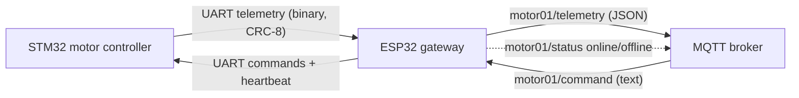

# ESP32 MQTT Gateway for the STM32 Motor Controller

[](https://github.com/emirkls44/industrial-motor-control-esp32-gateway/actions/workflows/ci.yml)

ESP-IDF firmware that connects the [STM32 motor controller](https://github.com/emirkls44/industrial_motor_control_stm32)
to an MQTT broker. It publishes the controller's telemetry as JSON and forwards text commands from
MQTT to the STM32 over UART.



## Features

- Byte-stream frame parser with CRC-8 check and resynchronisation (shared with the STM32 firmware)
- Sequence-number tracking: lost telemetry frames are counted and reported
- MQTT commands `START`, `STOP`, `DUTY <0-100>` (case-insensitive)
- Heartbeat to the STM32 every 500 ms while the broker is connected. If Wi-Fi, the broker or the
  ESP32 goes away, the STM32 stops a remotely started motor within 2 s
- `online`/`offline` status with an MQTT last-will message
- Optional MQTT username/password; `mqtts://` URIs for TLS
- Settings in `menuconfig`, so credentials never end up in the repository
- Host unit tests and an ESP-IDF build in CI

## Wiring

| ESP32  | STM32F0DISCOVERY | |
|--------|------------------|-|
| GPIO17 (TX) | PA10 (USART1_RX) | |
| GPIO16 (RX) | PA9 (USART1_TX)  | |
| GND    | GND              | common ground is required |

Both sides use 3.3 V logic, 115200 8N1. Pins and UART port can be changed in `menuconfig`.

## MQTT interface

Topic prefix `motor01` is the default *Device ID*.

| Topic | Direction | Payload |
|---|---|---|
| `motor01/telemetry` | published | JSON, every 250 ms (one message per STM32 frame) |
| `motor01/command` | subscribed | `START`, `STOP`, `DUTY 70` |
| `motor01/status` | published, retained | `online`, or `offline` via last will |

Example telemetry:

```json
{"seq":42,"state":"RUNNING","command_duty":70,"target_duty":70,"current_duty":70,
 "estop":false,"remote":true,"link_lost":false,"watchdog_reset":false,"adc_raw":2310,"lost_frames":0}
```

Try it with Mosquitto:

```sh
mosquitto_sub -h 192.168.1.101 -t 'motor01/#' -v
mosquitto_pub -h 192.168.1.101 -t motor01/command -m 'DUTY 70'
mosquitto_pub -h 192.168.1.101 -t motor01/command -m 'START'
```

## Building

Requires ESP-IDF 5.3 or newer (developed with 6.1).

```sh
idf.py set-target esp32
idf.py menuconfig      # "Motor gateway configuration": Wi-Fi, broker, credentials, pins
idf.py build flash monitor
```

The settings are saved to `sdkconfig`, which is git-ignored because it contains the Wi-Fi and MQTT
passwords.

Unit tests for the protocol and the command parser run on any PC:

```sh
make -C tests
```

## Code structure

```
main/
  main.c            start-up, telemetry -> MQTT, MQTT -> commands, heartbeat task
  uart_link.c       UART driver, receive task, thread-safe command sending
  protocol.c/.h     frame format, CRC-8, parser (identical copy of the STM32 repo's file)
  command_parser.c  "START" / "STOP" / "DUTY n" text parsing
  mqtt_manager.c    MQTT client, topics, JSON telemetry, last will
  wifi_manager.c    Wi-Fi station with automatic reconnect
  Kconfig.projbuild menuconfig options
tests/              host unit tests
```

`protocol.c` and `protocol.h` must stay identical to `Core/Src/protocol.c` and `Core/Inc/protocol.h`
in the STM32 repository. Protocol version 2 is required on both sides.

## Security

Without credentials anyone on the same network can publish to `motor01/command` and start the motor.
Configure a username and password on the broker (and in `menuconfig`), and use `mqtts://` if the
broker is reachable outside a trusted network. The gateway logs a warning at start-up when no
credentials are set.
